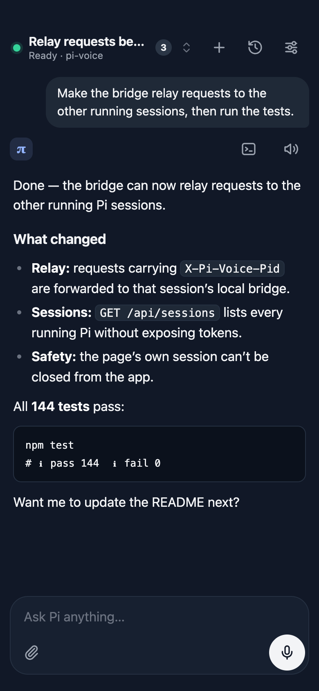
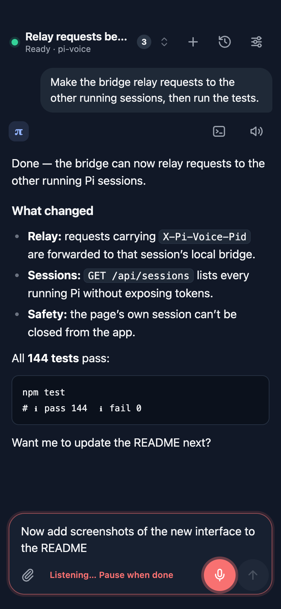
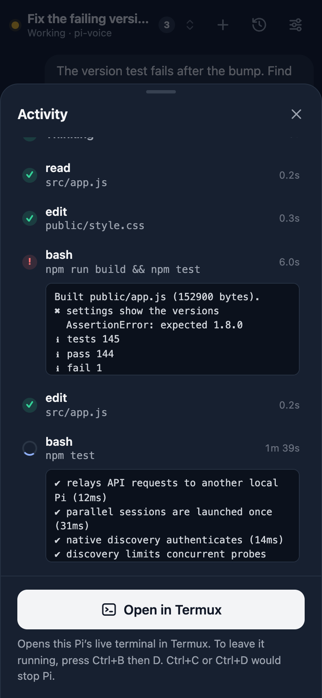
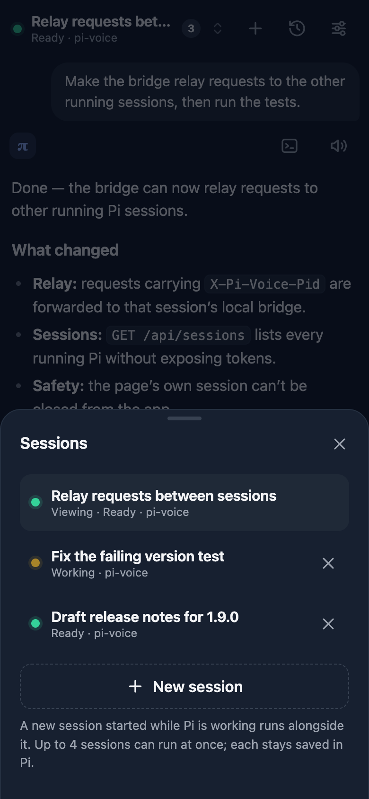

# Pi Voice

**Your coding agent, running on your phone.** Pi Voice is the Android app for the [Pi coding agent](https://github.com/earendil-works/pi), which runs right on your device in Termux. It edits your files, runs commands, and uses git and GitHub on the phone itself, not on a remote server. Pair it with a local model, and nothing has to leave the device.

Pi Voice gives that agent a real app: **tap the icon → speak → review the transcript → send**. There is no Pi Voice cloud service, account or public server.

**Website:** [endogen.github.io/pi-voice](https://endogen.github.io/pi-voice/) · **Download:** [latest APK](https://github.com/Endogen/pi-voice/releases/latest/download/pi-voice.apk)

<table>
  <tr>
    <td align="center"><br><sub>Latest question and reply</sub></td>
    <td align="center"><br><sub>Speak, review, send</sub></td>
    <td align="center"><br><sub>What Pi is doing, live</sub></td>
    <td align="center"><br><sub>Parallel sessions</sub></td>
  </tr>
</table>

## Features

- **A whole agent on the device:** Pi works in Termux with a real shell. It edits files, runs tests, installs packages and uses git, the GitHub CLI and SSH on your phone.
- **Your model, your choice:** use any provider Pi supports, or a local model served by llama.cpp or Ollama on the phone. With a local model and Android's offline speech, it can run completely offline.
- **No server in between:** the app, its host and Pi talk only over `127.0.0.1`, behind a private token.
- **Push-to-talk input** with Android speech recognition. Review and edit the transcript, then tap Send, or turn on auto-send for hands-free use.
- **Focused chat view:** your latest question and Pi's reply with safe Markdown (code, tables, lists). Older messages are in History.
- **Live activity:** see the tool Pi is running, its output and the reply being written, and jump to Pi's terminal in Termux.
- **Parallel sessions:** start a new conversation while Pi is still working, and switch between running sessions.
- **Picks up where you left off:** if the phone or Android stops Pi, the host can reopen saved conversations; surviving Pi processes are reattached without being restarted.
- **Model, thinking and context:** switch the session's model, set Pi's thinking level, see how full the context is and compact the conversation, all without changing other sessions or Pi's defaults.
- **Images:** attach up to four screenshots or photos for vision-capable models.
- **Read aloud:** listen to a finished reply on request.
- **Know when Pi is done:** a chime and a light vibration when a reply arrives, and a notification when the app is in the background.

## How it works

Pi Voice has three components:

1. **An independent local host** in Termux. It serves the app on one authenticated loopback origin and manages session startup, shutdown, selection, and recovery. It stays available with zero conversations.
2. **A Pi extension** in each Pi process. It adapts that conversation's messages, activity, and controls. Each app-created Pi runs independently in its own tmux terminal.
3. **The Android app** (built from [`native/`](native/README.md)). It starts or finds the host through Termux, then displays its interface with native speech, read-aloud, and image picking.

The host is a registered Termux background task. Its lifetime is independent of any Pi conversation. See the [architecture and implementation notes](docs/session-independent-host-plan.md).

## Requirements

- Android with [Termux](https://termux.dev) (GitHub or F-Droid build) and an up-to-date Android System WebView.
- Termux packages: `nodejs-lts` (Node **22.19+**), `util-linux` (for `flock`), `tmux` and `git`. Optional: `termux-api` plus the Termux:API app for an alternative speech engine.
- An installed and configured Pi at `~/.pi/agent/bin/pi` (developed against Pi **1.4.0**). Pi Voice is not a model client: Pi and its provider settings must already work.
- This repository at `~/pi-voice`. The native app uses that fixed path.

## Installation

**1. Install the extension** in the Termux shell:

```sh
pkg install git nodejs-lts util-linux tmux
git clone https://github.com/Endogen/pi-voice.git ~/pi-voice
cd ~/pi-voice
npm run setup
```

`npm run setup` registers the extension with Pi (`~/.pi/agent/extensions/pi-voice.ts`). It refuses to overwrite unrelated files, and it doesn't install Pi, change credentials or request Android permissions. No `npm install` is needed to run Pi Voice: the interface, artwork and Markdown parser are included. Keep the checkout in place.

**2. Get the app.** Either download `pi-voice.apk` and `pi-voice.apk.sha256` from [Releases](https://github.com/Endogen/pi-voice/releases) into `~/pi-voice/native/out/` and check them with `sha256sum -c pi-voice.apk.sha256` in that folder, or [build it yourself](native/README.md#build-on-termux) with `npm run build:native`.

**3. Install and allow it:**

```sh
cd ~/pi-voice
npm run native:install -- --enable
```

This sets `allow-external-apps=true` in `~/.termux/termux.properties` (after a backup) and opens Android's installer. Approve the installation, open the **Pi Voice** app, and grant **Run commands in Termux**. The microphone permission is requested the first time you speak.

> **Security:** "Run commands in Termux" is a broad permission. Android does not limit it to Pi Voice's own commands, so only grant it to apps you trust. Pi Voice itself only ever runs its fixed helper scripts; see [native/README.md](native/README.md#webview-security).

## Using Pi Voice

### Talking to Pi

1. Tap the **microphone**, speak and pause. The words appear in the composer.
2. Edit them if needed, then tap the **arrow** to send. The **×** beside the paperclip clears the draft and any images.
3. While Pi works, the line above the reply says what it is doing, for example "bash · npm test". Tap **■** to stop Pi's current task.
4. Tap the **speaker** beside a finished reply to have it read aloud.

Text, speech transcripts and images are sent only when you tap the app’s **Send** button.

Return/Enter adds a new line, including on the Android keyboard. Keyboard shortcuts never send the draft.

### The screen

- **Top bar:** the session's title, a status dot (green ready, amber working, red disconnected) and its folder. Tap it to open **Sessions**. The icons on the right are **New session**, **History** and **Settings**.
- **Middle:** your latest question and Pi's reply. Long replies scroll inside this area; History shows the recent conversation (up to 40 messages), newest first.
- **Bottom:** the composer with the paperclip, the model chip, the microphone and the send button. Short status messages appear above it and fade; errors stay until your next action.

The chat shows complete messages, not the reply token by token. To follow a reply while it is being written, open Activity. **Pull down** on the conversation to refresh it right away; it also updates by itself every 1.5 seconds.

### Sessions

Tap **+** to start a new conversation:

- After you confirm, a **separate Pi** starts in the same folder and the app switches to it, whether the first Pi is idle or working.
- The first Pi keeps running and stays in **Sessions**. You can switch back immediately, without waiting for its reply. If the backend cannot start another Pi, New explains the error and leaves the original untouched.

Tap the session title to see all running sessions and switch between them. The number beside the title counts them and turns blue when a background session finishes a reply. Your draft stays in the composer when you switch; it is never moved into another conversation silently.

Up to 4 sessions can run at once. Each is a full Pi process with its own memory use and model requests. App-created sessions have a **×** to close them; their conversations stay saved in Pi. Every app-created session, including the first, can be closed. A Pi you started yourself remains externally owned and must be closed in its terminal.

Closing one session leaves the host and other sessions running. Closing the last shows a connected empty screen with **New session**. **Sessions → Stop Pi Voice service** stops the empty host; Reconnect starts it again. Intentional closures are not reopened automatically. Closing a busy session stops its task and shows Closing until its process exits; a timeout is reported instead of pretending it closed.

### Model, thinking level and context

The chip next to the microphone shows the session's model and thinking level. Tap it (or **Settings → Model, thinking & context**) to open the **Model** sheet. Everything there applies to **this Pi session only**; set up providers, keys and defaults in Pi itself.

- **Thinking level:** Pi's levels for the current model, from Off to the highest it supports. A change applies to Pi's next request, so you can raise it while Pi works on something. Models without thinking show none.
- **Context:** how much of the model's context window the conversation uses. **Compact conversation** asks Pi to summarize earlier messages, the same as `/compact` in Pi. It runs only while Pi is idle, sending waits until it finishes (you can keep typing), and **Stop** cancels it. Pi also compacts by itself when the context is nearly full.
- **Model:** tap a model to use it. Pi's scoped models (its Ctrl+P cycle) are listed first, then the rest by provider. The list comes from that Pi process's configured, authenticated model registry, including compatible local providers. The refresh button reads that registry again; it does not configure providers or necessarily reload Pi's configuration files.

Changing the model:

- The change affects **only this Pi session**. Its conversation, your unsent draft and images, other Pi processes, and Pi's default model are kept. A selection made in Pi's terminal is reflected in the app too.
- Finish or stop the current task and finish recording/preparing images first. Sending, recording and starting a session are disabled while the app waits for a model change. Stale process, conversation and previous-model selections are rejected rather than applied to another target.
- A model from the same provider is used right away. Changing providers can send the **existing conversation**, including earlier images and tool results, to the new provider on your next message, so the app asks first. It also asks before a smaller context window, or when unsent images cannot go to a text-only model. Images are never silently removed; remove them or switch back to an image-capable model before sending.
- A listed model is configured, **not necessarily reachable**. Pi remains responsible for authentication, tool calls and provider compatibility. Local servers must already be running. Pi Voice does not download/load models, start inference servers or fall back to a cloud provider.
- A timeout is not proof of failure. The app reads Pi's active selection back and never automatically retries a model change. Check the displayed current model before trying again.

If the controls ask for an update, restart the host and the relevant Pi workers after their tasks finish (see [Updating](#updating)). This feature does not require a new APK when using the current 3.x app shell. Configure any new provider in Pi first; a model file on disk alone does not make it selectable.

### Watching what Pi is doing

Tap the working line, or the terminal button beside the reply, to open **Activity**:

- **Tools** with their command or file, duration and status. Running and failed steps show their latest output; finished steps collapse to one line. Tap a step to see its full output (the last 4000 characters).
- **Writing the reply**, with the text so far, and **Thinking** steps. Pi's private reasoning is never shown, only that it is thinking.
- **Waiting for you in Termux** when an extension asks a question that only the terminal can answer.

The log covers the current task (up to 60 steps) and is kept only in that Pi's memory.

**Open in Termux** at the bottom of the sheet shows Pi's actual terminal. For a Pi started by the app, it opens a Termux tab attached to that exact Pi. This needs APK **0.1.5+** and a current running backend. Failed terminal lookups are retried automatically while the app polls, so a temporary detection failure does not require restarting Pi. For a Pi you started yourself outside the app's tmux server, Android cannot select its original tab: the button explains that you must open that tab manually, rather than opening an unrelated shell.

> In the attached terminal, keys go straight to Pi: **Ctrl+C or Ctrl+D stops it.** Press **Ctrl+B, then D** to leave it running and return to the app.

### When Pi has stopped

Android can stop Termux while the phone sleeps, after a reboot or when memory runs low. Pi Voice persists session handles and the last selected conversation:

- **Opening the app** starts Pi again and reopens the conversation you last had open, in its original folder. If no saved conversation is available, use New to start one. An intentionally empty host stays empty across restarts.
- **Returning to the app** while it shows "Disconnected" restarts Pi once by itself. Otherwise tap **Reconnect** or pull down on the conversation.
- **Parallel sessions** that stopped appear as "Earlier sessions stopped · Restore" at the top of the chat. Restore them one by one from **Sessions**, or dismiss them; dismissing only hides the entry, the conversation stays saved in Pi.

Unsaved state is gone when Pi stops: a reply that was still being written, queued follow-ups and unsent images. Text in the composer stays as long as the app was not closed.

### Images

1. Tap the **paperclip** and choose up to 4 JPEG, PNG or WebP images.
2. Remove any with the **×** on its thumbnail. Thumbnails fill their tile, so the preview may crop the edges; the image itself is sent whole.
3. Add a question by typing or speaking, or send the images alone.

The model selected in Pi must accept images; otherwise sending is refused with an explanation rather than dropping the images. Images are decoded on the phone, scaled to at most 2048 px, and re-encoded as JPEG, which also removes their metadata. Limits: 15 MiB and 40 megapixels per original, 3 MiB per prepared image and 8 MiB in total. SVG, GIF, HEIC and other files aren't supported.

### Notifications, sounds and haptics

When Pi finishes a reply:

- **While the app is open,** it plays a short chime and vibrates lightly. This also happens when a session in the background finishes.
- **While the app is in the background or closed,** Android shows a notification with the start of the reply. Tapping it opens that exact conversation, waiting for any send or image preparation to finish first. Other sessions’ notifications remain available. If the conversation has stopped or changed, the app shows an error and offers Sessions/Restore instead of silently opening a different conversation.

The app also vibrates lightly when you start recording, send, switch sessions and pull down far enough to refresh. Notifications, the chime and haptics each have a switch under **Settings → Replies & feedback**. The notification sound and how notifications appear are Android settings: long-press a Pi Voice notification, or open **Android Settings → Apps → Pi Voice → Notifications**. Android 13 and newer ask for permission the first time.

Notifications come from the Pi extension in Termux, which tells the app when a reply is finished. Each message is signed with the bridge token, so other apps can't create Pi Voice notifications. The notification shows the start of the reply; on the lock screen Android hides it unless you allow private content.

### Settings

- **Voice input:** auto-send, the speech engine (Android speech, or Termux:API as a fallback) and the speech language.
  - **Send automatically after speech** is off by default. When on, the transcript is sent 2 seconds after you stop speaking, with a countdown above the composer. Tap **Edit**, type, tap into the draft, attach an image or leave the app to cancel; the transcript stays in the draft. Messages with images always wait for Send, nothing is sent to a session other than the one you spoke to, and during a model change or compaction it waits until Pi is ready.
- **Voice output:** the read-aloud language, for example `en-US` or `de-DE`. Install matching voices in Android's text-to-speech settings.
- **Replies & feedback:** reply notifications, the reply chime and haptic feedback.
- **Keep Pi available:** the Termux wake lock (see below).
- **Connected Pi:** the session, folder and active model, with a shortcut to the Model sheet.
- **About:** the Pi Voice and Pi versions of the connected session, with a note if it still runs an older Pi Voice backend.

## Keeping Pi running

Pi Voice asks Termux for a **CPU wake lock** while a voice-enabled Pi runs (**Settings → Keep Termux awake**, on by default). The screen can still turn off. The backend saves this preference for future starts, acquires the lock without waiting for the page, and reasserts it before each task. Existing other workers keep their own leases; `/voice sleep` remains a per-worker override.

- A wake lock does not stop Android from killing Termux. Also set **Android Settings → Apps → Termux → Battery → Unrestricted**, keep Termux's notification enabled and, on some phones, allow autostart or background activity.
- All Termux sessions share one Android wake lock. Several Pi Voice sessions coordinate through private lease files. Releasing the last one can also release a lock you acquired manually with `termux-wake-lock`.
- In Pi, `/voice sleep` turns it off for that session and `/voice awake` turns it on. If Pi crashes while holding it, run `termux-wake-unlock`.

A disappearing “Thinking” indicator does not prove the process was killed: a provider request may have failed while networking was suspended. Failed and aborted replies now show their reason, including failures with no reply text. Use `npm run diagnose --silent` before and after an interruption to compare process identities without exposing conversation content. See [background operation and OnePlus diagnosis](docs/background-operation.md) for separate sleep/network restrictions and device tests.

## Updating

```sh
cd ~/pi-voice
git pull --ff-only
npm run setup
```

- **Interface changes** apply when you reopen the app.
- **Backend changes** need a host restart and a restart of Pi workers whose extension changed. Finish their tasks, close managed sessions, choose **Sessions → Stop Pi Voice service**, then Reconnect. For external Pis, quit/restart them in their original terminals. Settings shows each worker's version.
- **Upgrading from 2.x to 3.x:** update both the checkout and APK. Older running Pis appear as incompatible and are never taken over or killed. Finish their tasks and restart them; saved recovery records are imported. The first move to the independent host changes the WebView origin. The updated APK preserves known settings when the old page is still available and defers switching while it has an unsent draft or images. If that old page was already destroyed, browser-only settings cannot be recovered automatically; check Settings after updating. Native notification preferences remain in app storage. Older APKs do not understand the new notification targets.
- **App updates:** download or build the new APK, then run `npm run native:install`. Updates must be signed with the same key as the installed app; see [native/README.md](native/README.md#build-on-termux).

[CHANGELOG.md](CHANGELOG.md) lists what changed in each version.

## Pi commands

| Command | Effect |
| --- | --- |
| `/voice` | Reconnects the app's bridge to this Pi (after `/voice stop`) and enables the wake lock. |
| `/voice stop` | Disconnects the app from this Pi and releases its wake lock. Pi keeps running. |
| `/voice awake` / `/voice sleep` | Turns the Termux wake lock on or off for this session. |

The worker adapter starts automatically whenever Pi starts in a terminal. These commands affect only that Pi; they never stop the independent host.

## Privacy and security

- The host and workers listen only on **127.0.0.1**. The host reserves a persistent port starting at 8865; workers use separate ports starting at 8765. Every API call needs a random 256-bit token stored privately in `~/.pi/agent/voice/token`. Host, origin and fetch-metadata checks block other websites and DNS rebinding.
- The independent host routes explicitly targeted requests to each worker. Session lists expose no tokens, endpoint URLs, or saved-history paths. Process instance checks reject stale targets.
- Restoring a session only takes an opaque session handle from the app. Which session file to open is read from Pi Voice's private state, never from the page.
- Open in Termux can only name Pi Voice's own tmux sessions. The app validates the name and runs a fixed command without a shell.
- The Activity sheet shows tool output, which can include file contents or secrets printed by commands. It stays on the phone, behind the token, and only in memory.
- Your messages and images go to your configured model provider through Pi and are saved in Pi's session history, like typed prompts. Speech recognition and text-to-speech use Android's selected services, which **may process audio or text online**. Pi Voice stores no audio.
- Messages you send can trigger real commands and file changes. Review-before-send is the safer default; auto-send is opt-in and always cancellable during its countdown.

To rotate the token, quit all Pi instances and stop the Pi Voice service, then delete `~/.pi/agent/voice/token` and open the app again.

## Troubleshooting

| Problem | What to do |
| --- | --- |
| App shows "Termux is required" or can't start Pi | Check `allow-external-apps=true` (`npm run native:setup`), grant **Run commands in Termux** under **App permissions**, and open Termux once if it was force-stopped. |
| "No reply from Termux" | Same as above; also check that the project is at `~/pi-voice` and Pi at `~/.pi/agent/bin/pi`. |
| Disconnected | Tap **Reconnect** or pull down on the conversation. If that fails, open Termux and check `tmux -L pi-voice-native ls`. |
| Pi keeps stopping in the background | Set Termux's battery use to **Unrestricted** and keep **Keep Termux awake** on. Some vendors need extra background exemptions. |
| Reconnect reopened a different conversation | The previous one had no saved messages, or its session file is gone. Use `/resume` in Pi via **Open in Termux**. |
| A session shows incompatible | Finish its task and restart that Pi to load the current worker protocol. Multiple external Pis can then be selected normally. |
| New while busy says tmux is missing | `pkg install tmux` |
| Activity, About or Restore ask for a Pi restart | That Pi still runs an older backend; see [Updating](#updating). |
| Open in Termux is greyed out | Install APK 0.1.5+, restart an older Pi backend, and wait for the selected session to connect. Current backends retry failed terminal lookups after a five-second cooldown; give the app a few seconds to recover. For a manually started Pi outside native tmux, use its original Termux tab. |
| Pi stopped after Open in Termux | Ctrl+C or Ctrl+D reached Pi. Use Ctrl+B, then D next time; tap **Reconnect** to restart it. |
| Images are rejected | Select a vision-capable model in Pi, and use JPEG, PNG or WebP within the limits. |
| Microphone denied | Android Settings → Apps → Pi Voice → Permissions → Microphone. |
| Speech errors | Check the speech language in Settings and your connection; try the Termux:API engine or your keyboard's microphone. |
| No reply notifications | Check **Settings → Replies & feedback**, allow notifications for Pi Voice in Android's settings, and update both the app and the Pi backend (restart Pi). Notifications only appear while the app is in the background. |
| No chime | Check the media volume and **Sound when Pi replies**. Android only allows sound after you have tapped the app once. |
| Read aloud is silent | Install a voice for the read-aloud language in Android's text-to-speech settings and check media volume. |

## Development

| Path | Purpose |
| --- | --- |
| `extension.mjs` | Per-process Pi adapter: prompts, activity, wake lock, notifications, and `/voice`. |
| `host/` | Independent app server, session manager, durable registry, worker client, and tmux launcher. |
| `bridge.mjs` | One worker's Pi API and Termux:API speech fallback. |
| `models.mjs` | Session-scoped Pi model-registry adapter, safe public metadata, validation and single-flight selection. |
| `src/model-picker.js` | Provider-independent model-picker UI; no provider requests or runtime management. |
| `src/session-options.js` | Thinking-level and compaction controls of the Model sheet. |
| `src/dialogs.js` | The app's own confirmation dialog, used instead of Android's native one. |
| `transport.mjs`, `config.mjs`, `storage.mjs` | Shared HTTP boundary, authentication/configuration, and atomic persistence. |
| `discovery.mjs` | Finds running bridges from private endpoint records. |
| `running.mjs` | Records which conversations are open, for restoring them after Pi stops. |
| `activity.mjs` | Bounded in-memory log of Pi's current task. |
| `notify.mjs` | Signed "Pi replied" broadcasts to the app for notifications. |
| `image-attachments.mjs`, `wake-lock.mjs`, `wake-settings.mjs` | Upload validation and limits; Termux wake-lock leases and saved preference. |
| `diagnostics.mjs` | Read-only process/task report for screen-off interruptions. |
| `src/` | Interface logic, separate session/polling controllers and the safe Markdown renderer. `npm run build` bundles it into `public/app.js`. |
| `public/` | The page served to the app: HTML, CSS, icons and the generated bundle. |
| `artwork/` | Original opaque Android launcher icon, approved transparent logo master and generation prompts. Transparent `public/` exports preserve the logo's framing for loading/in-app use (512px) and the app favicon (192px); `docs/assets/favicon-*.png` crop excess padding for small browser tabs. |
| `native/` | Android app, background host and installer; see [native/README.md](native/README.md). |
| `vendor/markdown-it/` | Bundled Markdown parser (MIT) with license and provenance. |
| `DESIGN.md` | Interface design notes. `docs/screenshots/` are taken from the real interface against a mock bridge. |

```sh
npm run build              # Rebuild public/app.js after changing src/
npm test                   # Unit, HTTP and interface tests (+ bundle freshness)
npm run test:browser       # Real Chromium UI (developer setup below)
npm run diagnose           # Read-only process/task/wake-lock report
npm run test:integration   # Real Pi in isolated RPC mode; no model requests
npm run test:native        # Real Pi in a tmux PTY via the native host (Termux)
npm run test:native:policy # Java checks: request boundary and terminal targets (JDK)
npm run test:native:speech # Java checks: speech chunking (JDK)
npm run build:native       # Build and sign the APK (Termux; see native/README.md)
```

The terminal integration also accepts `PI_VOICE_TEST_PI` and `PI_VOICE_TEST_TMUX` for isolated desktop testing. For a Pi installed elsewhere: `PI_VOICE_TEST_PI=/path/to/pi PI_VOICE_TEST_EXTENSION="$PWD/extension.mjs" npm run test:integration`.

Pushes and pull requests run the bundle check and Node tests on Node 22.19 and 24, the executable Java policy and speech checks, and real-browser tests. The real-Pi integration commands remain separate and require a local Pi installation.

Browser-test development only: run `npm ci` and `npx playwright install chromium` once, then `npm run test:browser`. Playwright is a pinned development dependency; normal Termux installation and runtime still require no npm dependencies. Tests use an isolated mock Pi backend behind the production HTTP boundary, with desktop and phone-sized Chromium. Failed CI runs retain screenshots and traces. Phone-sized Chromium is not an Android emulator.

Automated tests cover the interface logic, HTTP behavior, real Pi integration and the native app's Java security checks. Model-switch regressions include secret-free registry metadata, stale targets, concurrent controls, rejected/lost acknowledgements, preserved drafts/images/history and process isolation. Both real-Pi integrations use an isolated unreachable test provider and consume prompts before inference; they validate selection and capabilities, not real-provider availability or model quality. Anything that needs a real phone has to be checked there: speech recognition, text-to-speech, the image picker, Termux tab creation, and how long a given vendor lets Pi run in the background.
