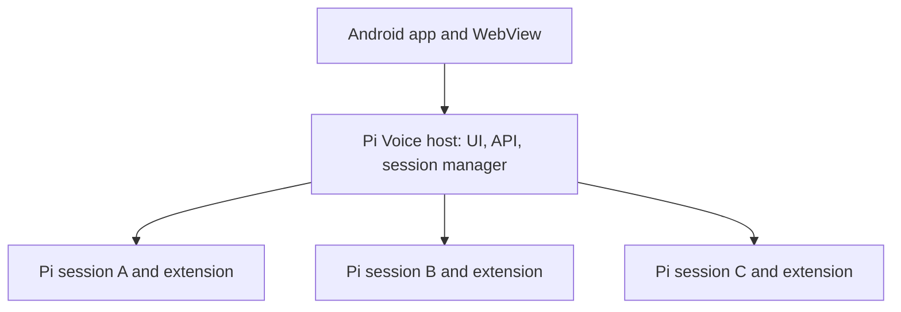

# Session-independent app host

Status: implemented in 3.0.0. Automated host/worker and native checks accompany the implementation. Real Android lifecycle, keyboard behavior, battery behavior, notification delivery, and upgrade UX still require device validation before release.

## Decision

Give Pi Voice its own local host, independent of every Pi conversation. Evolve the existing registered Termux Node host into this service. Every app-created Pi, including the first, becomes an equally managed session behind it.

The app keeps one authenticated origin while conversations start, stop, switch, or reload. Closing a conversation never transfers infrastructure responsibilities to another conversation.

This is a focused architectural rework of hosting, session lifecycle, and recovery. Keep interactive Pi in tmux, the extension API, the current frontend, and native speech/attachment support. No replacement model client or new process framework is needed.

## Evidence from the architecture before this change

- `bridge.mjs:createVoiceBridge` serves both static assets and session APIs inside a Pi process. Requests for another PID are relayed through that process. Its close endpoint explicitly refuses to close the bridge serving the page.
- `extension.mjs:onClose` only closes sessions with `PI_VOICE_SPAWN_ID`. The first session started by `native/host.mjs` does not receive this marker.
- `native/host.mjs:runNativeHost` keeps the registered Termux background task alive only while the initial `pi-voice` tmux session exists. Merely reconnecting to a surviving peer would not fix this lifecycle dependency.
- `native/connection.mjs:chooseConnection` favors a non-spawned Pi and rejects multiple such candidates. App discovery and conversation selection are currently the same decision.
- `src/app.js` distinguishes `hostPid` from `targetPid`, hides Close on the host, and falls back to the main session when a selected peer disappears.
- `running.mjs` stores recovery records under PIDs. `launchPlan` filters out spawned sessions and chooses by record update time. Selection is stored separately in browser local storage; it is not an authoritative host-side record of the last selected conversation.
- `MainActivity.java` trusts one verified origin. Changing the hosting Pi means changing that origin and potentially reloading the page; browser preferences are also origin-scoped.

A handover between Pi processes is technically possible, but would require coordinating origin changes, frontend state, process supervision, and failure during transfer. It also leaves a special host conversation and cannot represent zero conversations naturally. That makes it a weaker fit for the requested architecture.

## Responsibilities and boundaries

| Component | Responsibility |
| --- | --- |
| Native launcher and bootstrap | Ensure one registered host exists under the existing kernel lock; return its authenticated endpoint. Do not select a Pi as the app connection. |
| Host HTTP server | Serve the UI, app health, session list, lifecycle operations, and explicitly targeted session requests. Own the stable app origin. |
| Session manager | Serialize lifecycle changes, reserve capacity, launch and restore Pi, validate managed ownership, track closing and failed sessions, and reconcile survivors after restart. |
| Private registry | Persist managed handles, process identities, conversation references, selection, operation status, and intentional closure. Publish records atomically and version the schema. |
| Pi extension | Adapt only its own Pi: messages, activity, prompt submission, abort, graceful shutdown, terminal metadata, and local state. Never manage or relay to another Pi. |
| Android shell | Keep the existing narrow native capabilities and origin policy; support the versioned connection and notification identity contract. |

Suggested module boundaries: `host/server.mjs`, `host/session-manager.mjs`, `host/registry.mjs`, `host/worker-client.mjs`, and shared configuration/authentication/protocol modules. `native/host.mjs` becomes the composition root. `native/connection.mjs` must no longer import `extension.mjs` merely to obtain `stateDir`.

Retain authenticated loopback HTTP between host and workers initially. Extract reusable request validation and transport code from `bridge.mjs`; do not introduce another IPC mechanism while changing ownership. Workers expose only their own session operations; the host exposes app operations. All targets are resolved from validated private records, never arbitrary URLs or filesystem paths supplied by the page.

## Identity, concurrency, and persistence

Use separate identities for separate purposes:

- **Managed handle:** an opaque ID created before launch and retained when that managed session is restored. The UI selects this handle. A manually launched Pi receives an external registry handle without becoming app-owned.
- **Process instance:** PID plus verified start identity or a fresh worker instance nonce. This changes on restart and prevents stale commands from reaching a recycled PID or reused port.
- **Pi conversation ID:** the ID supplied by Pi, which can change through terminal `/new`, `/resume`, or `/fork`. Keep checking this on conversation-changing commands and prompt submission.

The host persists selection explicitly. Restoring a process updates its process instance without changing its managed handle. A conversation change inside a surviving process updates the registry and invalidates stale UI actions. Notifications must carry a versioned stable target and resolve through the registry instead of blindly selecting a PID.

Make the host the single writer of lifecycle records. Workers publish their own identity and current conversation metadata separately; they must not overwrite host close intent. Use atomic file replacement and a small versioned operation journal, with crash-injection tests defining the required durability. Keep private file permissions. Pi remains the owner of conversation history.

If persistence fails, the manager rejects further lifecycle actions until the host restarts and reloads durable state. This also handles writes whose outcome is uncertain after a rename. Fix the storage problem before restarting the host task; existing workers continue running independently. A conversation change invalidates its previous recovery path until a matching worker record arrives.

Serialize New/Restore/Close decisions in the manager. Count starting reservations and live-but-unresponsive managed processes against the session limit. Persist request IDs before launch, pass the operation identity to the worker, and reconcile the tmux target after a crash or lost acknowledgement before launching again. Restore must reserve the saved conversation too, preventing two writers opening the same history.

Prompt retry deduplication remains at the executing worker. Forward the original request ID; never retry an uncertain prompt against another conversation or a replacement process. If delivery cannot be established after a process loss, show that uncertainty and require a deliberate user retry.

## Lifecycle and user-visible behavior

1. **First installation:** start the host, publish its readiness, then create an initial managed conversation through the same manager used by New. The page can show startup progress independently of Pi readiness.
2. **New:** allocate a managed handle and operation, reserve capacity, launch Pi in a validated tmux session, authenticate its readiness, then make it selectable. Failed starts remain explicit failures and release reservations after reconciliation.
3. **Close any managed session:** verify handle, instance, and conversation; persist close intent; request abort/graceful shutdown; show Closing until process exit is confirmed. A timeout is an error, not a successful close. Do not silently force-kill or delete conversation history.
4. **Close the selected session:** choose the most recently viewed remaining live session, or show an empty state. Keep the draft and attachments visible, cancel recording/playback, and prevent automatic submission into the new selection. Ignore late responses from the previous selection.
5. **Close the last session:** retain the connected host and show New/Restore. Persist the empty selection so reopening the app does not resurrect an intentionally closed conversation.
6. **Worker crash:** mark only that session stopped or unavailable. Offer Restore when its saved conversation is valid; keep other sessions usable. A failed health probe alone does not establish process death.
7. **Host crash:** the app reconnects through the fixed native launcher. The new host authenticates and adopts surviving workers, reconciles operations and close intents, and restores selection without duplicate Pi launches. If Android killed the workers too, recover from saved conversations; in-flight execution cannot be recovered transparently.
8. **Terminal commands:** `/voice stop` detaches that Pi's adapter without stopping the app host. `/voice` reattaches it. Temporary reloads retain the managed handle and reconcile the current Pi conversation.
9. **Manually started Pi:** list it as external and allow selecting it without startup ambiguity. Preserve external ownership: closing it in the app remains unavailable unless a separate explicit adoption feature is later designed.

The host remains a registered Termux background task until explicitly stopped or terminated by the OS, including when no conversations are open. Expose a separate Stop Pi Voice service action when no managed sessions are running. Do not acquire a CPU wake lock merely to display the empty state. Initially preserve existing per-worker wake-lock leases and reply broadcasting, updating notification target identity and signatures as needed; neither feature should depend on the first session.

A single local host remains a shared point of availability. This design separates its recoverable infrastructure lifetime from conversation lifetime; it does not guarantee survival of Termux force-stop, reboot, or Android process termination. Measure idle host memory and background behavior on the phone before release.

## Connection, security, and upgrade contract

- Give the host a private endpoint record distinct from worker discovery. Bootstrap verifies endpoint role, protocol version, authentication, and process identity, not just a responding port.
- Reserve and persist the host port so worker restarts never change the WebView origin. On conflict, report an actionable failure rather than silently changing origins or taking another service's port. Choose the port during migration after checking existing workers.
- Preserve literal-loopback binding, bearer authentication, host/origin checks, CSP, request limits, no redirects, and narrow native commands. Authorize Close using verified managed ownership and identity; a relay marker is not an ownership model.
- Define host/worker/API capability versions. Incompatible workers remain visible with a restart-needed state and do not receive unsupported lifecycle commands.
- Treat this as a coordinated backend/frontend/native release, particularly for notification targets and preference migration. Do not claim that an old APK or already-running extension automatically supports the new contract.
- Migrate legacy running records and selection where identity can be verified. A record's `spawned` flag alone is insufficient to establish ownership of the legacy first Pi; validate its exact private tmux target and process. Leave ambiguous instances external.
- Do not restart busy old Pi processes during upgrade. Require a controlled restart to obtain the new worker protocol; preserve their saved histories and retain old recovery records until migration succeeds. Temporary legacy recognition must have an explicit removal point.
- The first move to a host origin needs a versioned preferences export/import through trusted native storage while the old page is still accessible. Reuse native preferences already stored there. If old browser-only preferences cannot be recovered, disclose that limitation instead of claiming migration; do not weaken cross-origin isolation to read them. Preserve unsent drafts during the controlled transition or defer it until the user has dealt with them.

## Implementation sequence and completion gates

1. **Protocol and persistence foundation.** Extract shared configuration/authentication; define identities, capabilities, registry schema, lifecycle states, and idempotency semantics. Test stale identities, atomic records, concurrent reservations, close intent, and conversation exclusivity.
2. **Independent host and manager.** Add the host server using existing transport protections and a worker client. Move launch, restore, session limits, discovery, and reconciliation out of the extension. Prove a live host with zero workers, then two equal workers, before wiring the app.
3. **Native startup and supervision.** Make the locked registered background task own the host lifetime, not one tmux session. Bootstrap discovers only the host. Test simultaneous launches, host restart with surviving workers, and no duplicate Pi on temporary unavailability.
4. **Frontend equality and recovery.** Replace `hostPid`/`targetPid` logic with explicit selected handles; use capabilities for Close; add empty, closing, unavailable, and restart-needed states. Persist selection through the host and preserve draft safety across switches.
5. **Migration and supporting contracts.** Update notifications and their native verification, terminal targeting, preferences transfer, docs, and version reporting. Validate upgrade failures without modifying existing conversation histories.
6. **Remove the old hierarchy and release.** Delete worker-to-worker relay and primary-session discovery from the supported path. Update existing tests that require the main session to stay open, regenerate `public/app.js` through the normal build, and ship the coordinated release after integration/device validation.

Required acceptance scenarios:

- Start A and B; close A while B is working. The origin stays the same, B keeps its process and task, and Termux still tracks the host.
- Close B as the final session, see a connected empty state, and start C without recreating a hidden main conversation.
- Close a selected busy session; observe real shutdown completion, no premature removal, and no late speech or prompt delivery to the replacement selection.
- Kill a worker; other sessions continue. Kill/restart only the host; surviving workers are rediscovered without duplication. Kill all Termux processes; restore saved sessions and selection correctly.
- Interrupt every launch/restore/close transition, including after process launch but before readiness and after close intent but before shutdown. Retried requests and concurrent clients must converge on one operation.
- Exercise PID/port reuse, `/new`, `/resume`, `/reload`, malformed discovery, incompatible versions, missing tmux, and failed launches.
- Verify multiple external Pis are selectable and cannot be closed as managed sessions.
- Verify notification taps, exact Open in Termux targets, origin restrictions, preferences, drafts, attachments, speech cancellation, and empty-host idle behavior on Android.

Use the existing unit suites, real Pi integration suite, native tmux integration, and Java policy tests, extending them at these boundaries. Architecture review alone does not establish Android lifecycle behavior; the release gate includes real-device validation.
